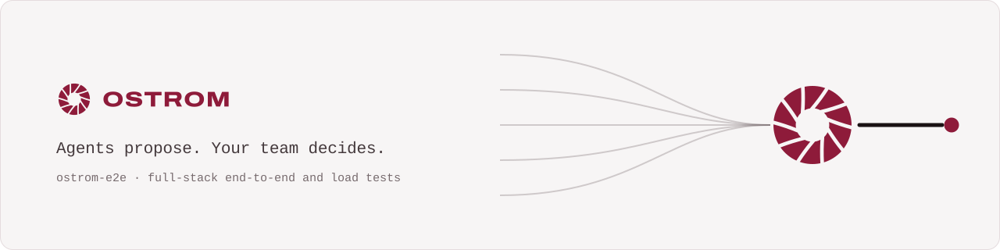
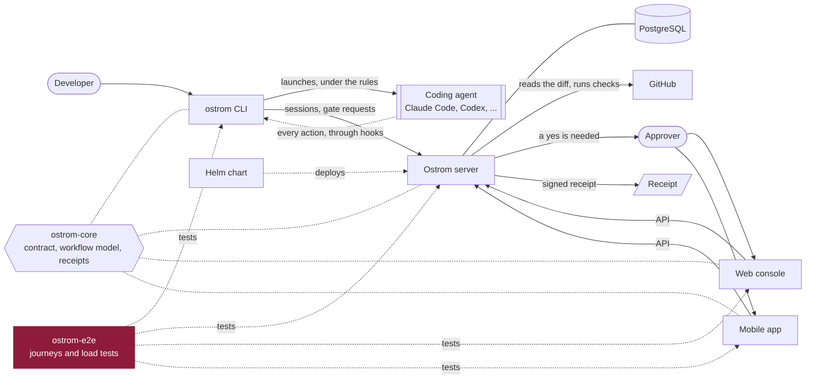

<p align="center">
  <a href="https://ostrom.run">
    <picture>
      <source media="(prefers-color-scheme: dark)" srcset=".github/assets/banner-dark.svg">
      
    </picture>
  </a>
</p>

<p align="center">
  <strong>Ostrom runs a company's AI coding agents in the cloud and makes them follow the team's rules.</strong><br>
  Every change they make leaves a receipt, and the few that matter wait for a person's yes.
</p>

<p align="center">
  <a href="https://ostrom.run">Website</a> ·
  <a href="https://ostrom.run/docs">Docs</a> ·
  <a href="https://github.com/ostrom-hq/ostrom-e2e/discussions">Discussions</a> ·
  <a href="CONTRIBUTING.md">Contributing</a> ·
  <a href="SECURITY.md">Security</a>
</p>

<p align="center">
  <a href="https://github.com/ostrom-hq/ostrom-e2e/actions/workflows/ci.yml"></a>
  <a href="CONTRIBUTING.md#tests-the-bar"></a>
  <a href="LICENSE"></a>
  <a href="CHANGELOG.md"></a>
</p>

## What this is

End-to-end and load tests of Ostrom: the real native server with PostgreSQL, the real `ostrom` binary, and a fake agent
that plays the hooks the way Claude Code and Codex do. Apache 2.0.

## How it fits



## Status

Ostrom is before its first public release. Which journeys are covered, and which are still `todo`, is tracked
scenario by scenario in [`SCENARIOS.md`](SCENARIOS.md); the nightly load runs skip, with a note, until the server meets
the bench contract.

## Layout

| Path | What |
|---|---|
| `SCENARIOS.md` | the catalogue of journeys to cover, with their status |
| `RAPPORT.md` | the test dashboard of every repository: coverage, number of tests, scenarios, load |
| `scenarios/` | the runnable scenarios (Vitest); a scenario not written yet shows as `todo` in the CI report |
| `bin/fake-claude`, `bin/fake-codex`, `src/fake-agent.ts` | the fake agent |
| `src/fake-github.ts`, `src/git.ts` | a fake GitHub and throwaway git repositories for the scenarios |
| `src/fake-tokens.ts` | a fake provider token endpoint, for the shared accounts the import revives |
| `load/` | k6 scripts: smoke, soak and ramp, the race of 100 simultaneous yes, and the gateway and MCP relay passes |
| `templates/` | the test CI templates of the other repositories and the contract of the test bench |
| `.github/actions/` | composite actions that build and start the real server and the real CLI |

## Run

```sh
pnpm install
pnpm test:coverage   # the bench's own code, 100 % coverage
pnpm e2e             # full-stack scenarios: set OSTROM_E2E_SERVER_URL and OSTROM_E2E_CLI_BIN
pnpm report          # regenerates the scenario table of RAPPORT.md
```

CI (`.github/workflows/ci.yml`) is one job, `ci`, on every pull request and on `main`: `pnpm typecheck`, actionlint,
`k6 inspect` of the load scripts, `pnpm test:coverage`, then the real server and CLI are built and started and
`pnpm e2e` runs the scenarios. `nightly.yml` runs the k6 soak and ramp (`load/soak.js`) and the race of 100 simultaneous yes, of which
exactly one must win (`load/race.js`), against the server built from `ostrom-server` main; it skips them, with a note in
the job summary, while that server does not meet the bench contract. The short k6 run on server pull requests is a
template (`templates/server/ci-extra.yml`) not installed in `ostrom-server` yet.
`chart-load.yml` (main, every night, by hand; never on pull requests) installs the server image of `ostrom-server` main
with the `ostrom-helm` chart in kind (built-in PostgreSQL, migrate init container, 2 replicas, ingress-nginx) and runs
`load/smoke.js`, `load/chart-journeys.js` and, once `scripts/load-setup.ts` reports ready, the gates and the race
through the ingress; its job summary gives p95/p99, errors and requests/s per script, and the peak CPU and memory of
every pod. It also loads the inference gateway and the MCP relay against fake upstreams (`src/fake-upstreams.ts`, in a
namespace of their own; `scripts/relay-load-setup.ts` makes the member, its token and the MCP servers): the gateway's
overhead against the fake provider called directly, at p50, p95 and p99 of the first byte and of the end, JSON and
stream (`load/inference.js`, under 15 ms at p95); a ramp of 50 to 300 streams open at once (`STREAM_RAMP`) and the
memory each costs, with no server restart: each stream ends whole or, past what the replicas hold
(`OSTROM_GATEWAY_MAX_OPEN_CALLS`), is refused at once as overloaded (`load/streams.js`); a client that leaves mid-stream, whose upstream connection and usage must be
released within 2 s (`load/cut.js`); and MCP servers that answer at once, late, never or not at all, at the same time
(`load/mcp.js`). `scripts/relay-summary.ts` writes the overhead and memory tables. Each of these phases starts on Ready
server pods and fails on a restart of its own, with the crashed container's last lines (`scripts/server-pods.sh`).
The workflow runs in two legs, each on its own runner and kind cluster: `gates` (the smoke, the journeys, the gates
and the race) and `relay` (the smoke, the journeys, then the gateway and the relay). Both build the server image and
open the port-forward and the mail directory of the sign-in; only `gates` runs `scripts/load-setup.ts`, only `relay` the
CA and the fakes. A crash in one never decides the other's numbers. Their artifacts are `chart-load-k6` and
`chart-load-k6-relay`; a dispatch may run one leg only (`pass`), and build another ostrom-server ref (`server_ref`, a PR's branch) to prove a
fix before it merges. The relay leg also keeps each server container's log,
followed across restarts, and its open descriptors every second (`scripts/server-watch.sh`, in `server-watch/`).

## Documentation

The public documentation is at [ostrom.run/docs](https://ostrom.run/docs). The engineering conventions shared by every
Ostrom repository are in `ostrom-core`, `docs/CONVENTIONS.md`.

## Repositories

| Repository | What it is | License |
| --- | --- | --- |
| [ostrom-core](https://github.com/ostrom-hq/ostrom-core) | Shared Kotlin Multiplatform library: API contract, workflow model, signed receipts | Apache-2.0 |
| [ostrom-cli](https://github.com/ostrom-hq/ostrom-cli) | The `ostrom` command line: runs coding agents under the team's rules | Apache-2.0 |
| [ostrom-server](https://github.com/ostrom-hq/ostrom-server) | The server: gates, receipts, policies, the API | AGPL-3.0 + ee |
| [ostrom-web](https://github.com/ostrom-hq/ostrom-web) | The web console | AGPL-3.0 + ee |
| [ostrom-app](https://github.com/ostrom-hq/ostrom-app) | The iOS and Android app | AGPL-3.0 + ee |
| **ostrom-e2e** (this one) | Full-stack end-to-end and load tests | Apache-2.0 |
| [ostrom-site](https://github.com/ostrom-hq/ostrom-site) | ostrom.run: website, documentation, blog | Apache-2.0 |
| [ostrom-helm](https://github.com/ostrom-hq/ostrom-helm) | Helm chart and Docker Compose for self-hosting | AGPL-3.0 |

## Contributing

Contributions are welcome. Read [CONTRIBUTING.md](CONTRIBUTING.md) (setup, tests, Conventional Commits, DCO), the
[Code of Conduct](CODE_OF_CONDUCT.md), and [SECURITY.md](SECURITY.md) to report a vulnerability privately. Questions
go to [Discussions](https://github.com/ostrom-hq/ostrom-e2e/discussions); help options are in [SUPPORT.md](SUPPORT.md).

## License

Apache License 2.0, see [LICENSE](LICENSE) and [NOTICE](NOTICE). You can use it in any project, open source or not.
